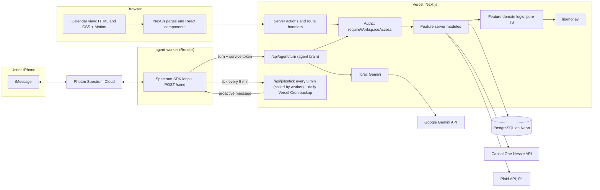
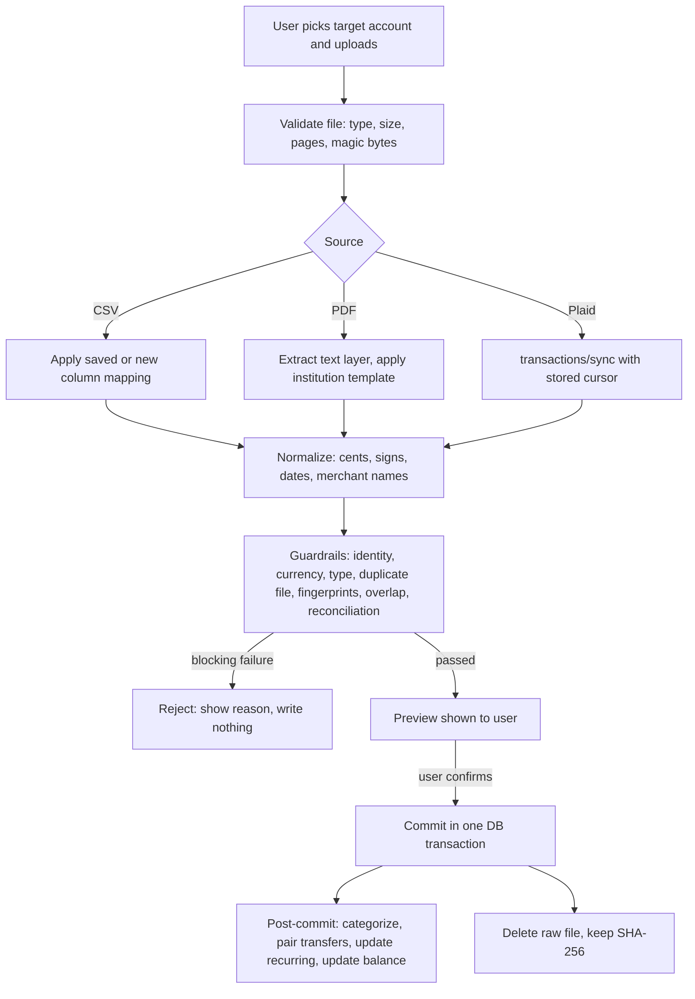
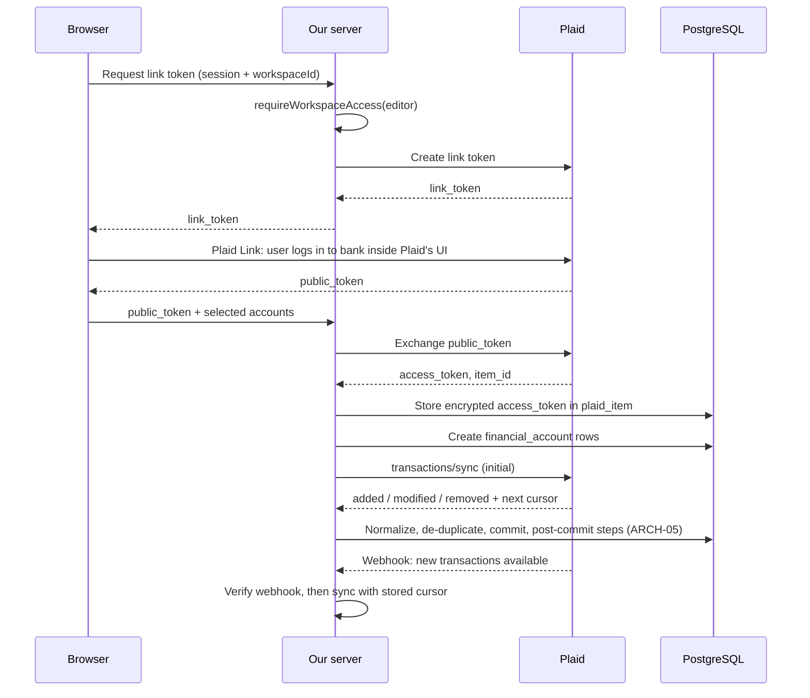
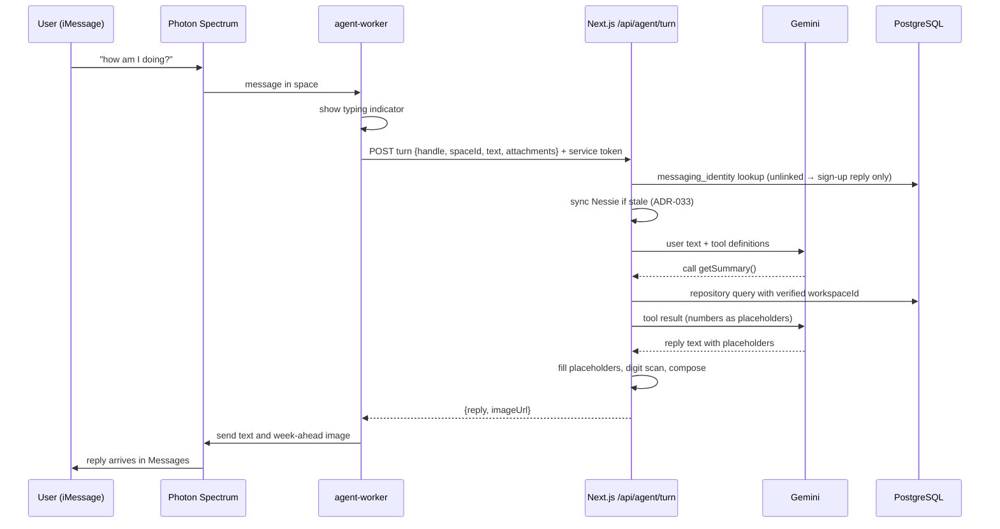

# ARCHITECTURE

How the system is built. Each section is numbered (ARCH-xx) and names the
decisions that govern it. If this file and `DECISIONS.md` disagree, the ADR
wins; fix this file in the same PR.

---

## ARCH-01: System overview

Governed by: ADR-003, ADR-004, ADR-005, ADR-006, ADR-012, ADR-019

Key properties:
- One Next.js application holds all business logic. The only other process
  is the thin agent worker (ADR-032), which holds no logic and no database
  access.
- Neither the browser nor the worker talks to the database, Nessie, Plaid,
  or Gemini directly.
- All business rules live in pure `domain/` code that is tested without a
  database.

## ARCH-02: Code layout and dependency rules

Governed by: ADR-003, ADR-046, AGENTS.md section 6

| Layer | Location | May import | Must not import |
|---|---|---|---|
| Routes | `src/app/**` | feature `index.ts`, `components/ui`, `lib/auth` | `lib/db` directly |
| Feature UI | `src/features/*/ui` | own `domain`, `components/ui`, `lib/money` (formatting) | `server/` code, `lib/db` |
| Feature server | `src/features/*/server` | own `domain`, `lib/*` | other features' internals |
| Feature domain | `src/features/*/domain` | `lib/money`, other pure domain via `index.ts` | anything with I/O |
| Shared libs | `src/lib/*` | other `lib/*` | `features/*` |

Planned features (each a folder in `src/features/`):
`workspaces`, `accounts`, `transactions`, `imports`, `categorization`,
`budgets`, `recurring`, `goals`, `transfers`, `cashflow`, `forecast`, `debt`, `plaid`,
`nessie`, `reminders`, `agent`, `messaging`, `ai`, `audit`, `synthetic` (the
batch generator, ADR-049).

Scripts in `scripts/` run with plain `node`. Those that import from `src/`
load `scripts/register-paths.ts` first, so `@/…` and extensionless imports
resolve the way they do in Next.js and Vitest. They cannot import
`server-only` modules (`src/lib/db/client.ts`, `src/lib/env.ts`), so they
open their own connection to a named target (`scripts/db/target.ts`).

The repository is a pnpm workspace (ADR-032): the Next.js app at the root,
and `agent-worker/` as a second package. The worker may import only from
`agent-worker/` and a shared `packages/agent-protocol/` types package (the
request and response shapes of `/api/agent/turn` and `/send`); it never
imports from `src/`.

Styling (ADR-046): design tokens are CSS custom properties in
`src/app/globals.css`; each component has a CSS Module that uses them.
Tailwind is a fallback for a single element, never a component's main
styling.

## ARCH-03: Data model

Governed by: ADR-005, ADR-006, ADR-007, ADR-008, ADR-010, ADR-012, ADR-025, ADR-049

Better Auth owns `user`, `session`, `account` (login providers),
`verification`, and, through the organization plugin, `organization`
(= workspace), `member`, `invitation`. Our tables reference
`organization.id` as `workspace_id`.

All money columns: `bigint` (cents). All ids: text. Better Auth's tables use
Better Auth's id format; ours use UUID v7 (`src/lib/db/id.ts`). All tables have `created_at`, and mutable tables
have `updated_at`.

| Table | Key columns | Notes |
|---|---|---|
| `workspace_settings` | workspace_id (PK), kind (`personal`/`household`), timezone, cushion_target_cents (nullable) | Used only by the aquarium (ADR-016, superseded); drop it unless ADR-042 finds a use |
| `financial_account` | id, workspace_id, institution_name, type (`checking`/`savings`/`credit_card`/`loan`), mask_last4, nickname, source (`manual`/`text`/`csv`/`pdf`/`plaid`/`nessie`/`synthetic`), current_balance_cents, balance_as_of, identity_confirmed_at, plaid_account_id (nullable), nessie_account_id (nullable) | Unique (workspace_id, plaid_account_id); unique (workspace_id, nessie_account_id). Built (migration 0002) |
| `transaction` | id, workspace_id, financial_account_id, posted_on (date), amount_cents (signed, ADR-008), description_raw, merchant_normalized, category_id (nullable), status (`pending`/`posted`), is_transfer, transfer_pair_id (nullable; both sides of a transfer share it), source, import_batch_id (nullable), external_id (nullable), fingerprint | Unique (financial_account_id, fingerprint). Built (migration 0002) without `category_id` and `import_batch_id`; each arrives with the table it references |
| `synthetic_batch` | id, label, generator_version, seed, start_month, months, as_of, spec (jsonb), notes, created_by, promoted_from | A replayable recipe (ADR-049). Built |
| `synthetic_workspace` | workspace_id (PK, cascade), batch_id (restrict), person_key, persona, summary | The synthetic marker: a row means the workspace is synthetic, no row means real (ADR-049). Built |
| `category` | id, workspace_id, name, color_token, sort_order, is_preset | |
| `budget` | id, workspace_id, category_id, month (`YYYY-MM`), amount_cents | Unique (category_id, month) |
| `category_rule` | id, workspace_id, pattern, match_type, category_id, priority, origin (`user`/`ai_confirmed`) | |
| `recurring_series` | id, workspace_id, financial_account_id, merchant_normalized, median_amount_cents, cadence (`weekly`/`monthly`), last_charged_on, user_intent (`none`/`keep`/`cancel`), manual (bool), kind (`subscription`/`bill`), next_due_on (nullable), due_date_source (`lender`/`user`/`predicted`), autopay (bool) | Subscriptions are `kind = subscription` only (ADR-030) |
| `reminder` | id, workspace_id, recurring_series_id, due_on, remind_on, status (`scheduled`/`sent`/`cancelled_paid`/`dismissed`), channel (`in_app`/`imessage`), low_balance_warning (bool), sent_at | Unique (recurring_series_id, due_on) so each cycle reminds once |
| `savings_goal` | id, workspace_id, name, target_cents, saved_cents, target_date, active | One active goal in MVP |
| `import_batch` | id, workspace_id, financial_account_id, kind (`csv`/`pdf`/`plaid`/`nessie`), file_sha256 (nullable), period_start, period_end, opening_balance_cents, closing_balance_cents, reconciliation (`passed`/`failed`/`not_applicable`), rows_imported, rows_skipped_duplicate, status (`previewed`/`committed`/`rejected`), created_by | Unique (financial_account_id, file_sha256) |
| `csv_mapping` | id, workspace_id, institution_name, column_map (jsonb), date_format, sign_convention | Reused per institution |
| `plaid_item` | id, workspace_id, plaid_item_id, institution_name, access_token_ciphertext, access_token_iv, transactions_cursor, status | Ciphertext only (ADR-012) |
| `liability` | id, workspace_id, financial_account_id, apr_bps, minimum_payment_cents, next_due_on, source (`plaid`/`mock`) | P2 |
| `messaging_identity` | id, user_id, workspace_id (personal), platform (`imessage`), handle, space_id, verified_at, proactive_opt_in (bool), alert_prefs (jsonb), revoked_at | Unique (platform, handle) among non-revoked rows (ADR-034) |
| `agent_link_code` | id, user_id, code_hash, expires_at, used_at | Single use, 10-minute expiry |
| `nessie_link` | workspace_id (PK), nessie_customer_id, last_synced_at | One sandbox customer per workspace (ADR-033) |
| `outbound_message` | id, messaging_identity_id, kind (`subscription_alert`/`bill_reminder`/`weekly_recap`), dedupe_key, scheduled_for, sent_at, status | Unique dedupe_key; enforces quiet hours and daily cap (ADR-038) |
| `audit_event` | id, workspace_id (nullable), actor_user_id, action, target_type, target_id, created_at, ip_hash | No financial details |

Indexes: every table indexed on `workspace_id`; `transaction` also on
(`workspace_id`, `posted_on`) and (`financial_account_id`, `posted_on`).

## ARCH-04: Request lifecycle and authorization

Governed by: ADR-006, ADR-007

Every server action and route handler that touches financial data does, in
order:

1. Get the session from Better Auth. No session → 401 / redirect to sign-in.
2. Parse inputs with `zod`, including `workspaceId` from the URL.
3. `requireWorkspaceAccess(session, workspaceId, minimumRole)`: loads the
   membership; throws `NotFound` (not `Forbidden`, to avoid revealing that a
   workspace exists) when the user is not a member or lacks the role.
4. Call the feature's server function, passing the verified `workspaceId`.
   Repository functions take `workspaceId` as a required first argument and
   include it in every `WHERE` clause.
5. Return plain serializable data. Never return ciphertext, tokens, or other
   workspaces' rows.

| Action | Minimum role |
|---|---|
| View any data | viewer |
| Add / edit / delete transactions, budgets, rules, goals; run imports; link banks | editor |
| Invite members, change roles, delete workspace | owner |

Caching: pages under `/w/[workspaceId]` render dynamically. No `unstable_cache`
or fetch caching of workspace data. Client state is keyed by workspace id and
cleared on workspace switch and sign-out.

## ARCH-05: Import pipeline

Governed by: ADR-009, ADR-010, ADR-012, ADR-020, ADR-025, ADR-044

- CSV and PDF parsing is done by code only; no AI model sees the file or
  produces a value (ADR-044).
- `preview` performs no writes except a `previewed` import batch row.
- `commit` is idempotent per batch: re-running a committed batch does nothing.
- Plaid sync runs on webhook receipt and on user request; it uses the same
  normalization and post-commit steps (no preview step).

## ARCH-06: Calendar computation and rendering

Governed by: ADR-014, ADR-018, ADR-026, ADR-042

1. Server builds a `CashflowSnapshot` for the active workspace: liquid
   balance, transactions with their source (bank, manual, text), recurring
   income, bills and subscriptions, the active goal, forecast inputs.
2. Pure functions in `src/features/cashflow/domain/` return the month view
   (each day's items, totals and end balance) and the summary (balance
   today, what is due before payday, the per-day amount).
3. The client renders the calendar from those results only. It does no
   money math.
4. The headline, day panel and accessible labels come from the same
   results, so the visual and the text can never disagree.

## ARCH-07: AI layer

Governed by: ADR-019, ADR-045

- `src/lib/ai/client.ts`: Google Gemini API wrapper using the `@google/genai`
  SDK (server-only). Nothing outside `lib/ai` imports the SDK directly.
- `src/lib/ai/fill.ts`: replaces placeholders with formatted values from code.
- `src/lib/ai/digitScan.ts`: rejects outputs containing digits not inserted by
  `fill.ts`; on rejection, fall back to a fixed template.
- "Ask Reeflect" exposes read-only tools (for example
  `getCategorySpend(workspaceId, month, categoryId)`) that call the same
  repository functions as the UI, with the same authorization.
- The website summary panel (ADR-045) sends code-computed aggregates to
  Gemini, fills the placeholders in its reply, runs the digit scan, and falls
  back to a fixed template with the same figures.

## ARCH-08: Security controls

Governed by: ADR-006, ADR-007, ADR-010, ADR-012, ADR-019, ADR-025

| Threat | Control |
|---|---|
| Reading another workspace's data (IDOR) | Authz on every entry point (ARCH-04); repository functions require `workspaceId`; route-matrix isolation tests (TESTING) |
| Session theft, CSRF | Better Auth secure HTTP-only cookies and CSRF protection; server actions only accept POST |
| Credential stuffing | Rate limiting on auth endpoints; generic error messages |
| Malicious uploads | Size, page and type limits; magic-byte check; parse with no script execution; timeouts; files never served back |
| CSV formula injection on export | Prefix cells starting with `=`, `+`, `-`, `@` when exporting (P2) |
| Leaked aggregator tokens | AES-256-GCM encryption at rest; key only in env; never returned or logged |
| Secrets in client bundle | Only `NEXT_PUBLIC_*` reaches the client; CI scans the build output (TESTING) |
| Forged webhooks | Verify Plaid webhook signature before processing |
| AI data leakage or invented numbers | Minimal data to the model; placeholders; digit scan (ARCH-07) |
| Vulnerable dependencies | `pnpm audit` in CI; CodeQL; Dependabot alerts |
| Sensitive data in logs | Log ids only; redaction helper in `lib/security/redact.ts` |
| Secrets in `public/` | Everything in `public/` is served as is and is not covered by `scan:bundle`. Never put a key there. The vendored Nessie SDK that held a hard-coded key was removed in HO-028; the key is still in git history (ADR-048, HO-026) |
| Scripts writing to the wrong database | Scripts take a named `--target`, print its endpoint id, and refuse production unless `NEON_PRODUCTION_ENDPOINT_ID` matches (ADR-049) |

## ARCH-09: Configuration

| Variable | Used by | Secret |
|---|---|---|
| `DATABASE_URL` | Drizzle at runtime, through `pg` (Neon's pooled connection string in production) | Yes |
| `DATABASE_URL_UNPOOLED` | Drizzle Kit migrations only (Neon's direct connection string); optional, falls back to `DATABASE_URL` | Yes |
| `BETTER_AUTH_SECRET` | Better Auth | Yes |
| `BETTER_AUTH_URL` | Better Auth | No |
| `BETTER_AUTH_API_KEY` | Better Auth Infrastructure dashboard (`dash()` plugin, ADR-047); optional, the plugin is left out without it | Yes |
| `ENCRYPTION_KEY` | `lib/security/crypto.ts` (32 bytes, base64) | Yes |
| `PLAID_CLIENT_ID`, `PLAID_SECRET`, `PLAID_ENV` | Plaid client | Yes (secret) |
| `GEMINI_API_KEY` | `lib/ai` (Google Gemini API) | Yes |
| `GEMINI_MODEL` | `lib/ai` (model name, set at kickoff) | No |
| `NESSIE_API_KEY` | `features/nessie` (sent as a query parameter; logs must redact it) | Yes |
| `NESSIE_BASE_URL` | `features/nessie`: `https://api.nessieisreal.com` (ADR-048) | No |
| `AGENT_SERVICE_TOKEN` | Next.js and worker (shared secret, 32+ random bytes) | Yes |
| `AGENT_WORKER_URL` | Next.js (where to POST proactive messages) | No |
| `REEFLECT_URL` | Worker (where to POST turns) | No |
| `PHOTON_PROJECT_ID`, `PHOTON_PROJECT_SECRET` | Worker only | Yes (secret) |
| `CRON_SECRET` | Vercel Cron routes | Yes |
| `DEMO_MODE` | Brain (`true` only on the demo deployment) | No |
| `DATABASE_URL_BATCHTESTINGBRANCH` | Scripts only: the Neon batch-testing branch (ADR-049). `_UNPOOLED` is optional; scripts derive the direct URL | Yes |
| `NEON_PRODUCTION_ENDPOINT_ID` | Scripts only: production's endpoint id (`ep-…`). Scripts refuse to write to production unless it matches | No |

All variables the app reads are validated at startup with `zod` in
`src/lib/env.ts`; the app refuses to start if a required one is missing
(`src/instrumentation.ts`). Script-only variables are not in `env.ts`; the
scripts check them when they need them.
`env.ts` and `.env.example` list the variables in use so far; each PR that
first reads a variable adds it to both.

`GET /api/health` runs one trivial query through the runtime pool and
returns `ok` or 503, with no data and no error details. Use it to confirm the
Neon connection after a deploy.

## ARCH-10: Environments and deployment

| Environment | Database | Plaid | Purpose |
|---|---|---|---|
| Local | PostgreSQL in Docker (`docker compose up -d`, port 5433), or Neon production through `.env.local` | Sandbox | Development |
| CI | PostgreSQL service container | Mocked in unit tests; sandbox not called | Tests |
| Batch testing | Neon batch-testing branch, a child of production | Not used | Trying synthetic batches before promoting them (ADR-049) |
| Preview (per PR) | Neon branch or shared preview database | Sandbox | Review |
| Production / demo | Neon's root branch, named `production` in the Console (`main` when created by the CLI) | Sandbox for the demo | HackNC demo |

The agent worker runs on Render (ADR-032; an always-on instance, not the free tier that sleeps) in the demo
environment and as a local process (`pnpm --filter agent-worker dev`) with
the terminal provider during development. Nessie is called only from local,
preview and demo environments, never from CI unit tests (mocked) except the
nightly `@external` job.

Migrations run before the new version serves traffic. A migration that
deletes or rewrites data needs its own ADR.

**Which database, and which version of the tables:**

- **Which database:** the app uses whatever `DATABASE_URL` it started with.
  - The host's first part (`ep-…`, without `-pooler`) is the Neon branch's
    endpoint id.
  - Changing branch means changing `DATABASE_URL` and
    `DATABASE_URL_UNPOOLED` together, then restarting `pnpm dev`. On Vercel,
    change the variable and redeploy.
  - Marking another branch as DEFAULT in Neon does not move the app.
- **Which tables:** each database records the migrations applied to it in
  `drizzle.__drizzle_migrations`, matched to
  `src/lib/db/migrations/meta/_journal.json` by timestamp.
  - Only `pnpm db:migrate` (or `db:migrate:to`) changes it.
  - Never change tables by hand.
  - A branch copies its parent's tables and migration history at the moment
    it is created.
- **`pnpm db:whoami [--target app|local|branch|production]`** prints the
  endpoint id, the database it recognises, the migrations applied and
  pending, and the synthetic batch count. It never prints a password.

**Drizzle's rule:** it applies every migration newer than the newest one
recorded. If a migration is regenerated after it was applied somewhere, that
database records the old draft, and the next `db:migrate` tries to run the
new file again. This happened with `0001_better_auth` on Neon production
(HO-026).

## ARCH-11: Plaid integration

Governed by: ADR-012, ADR-010, ADR-020, ADR-025

| Module | Location | Responsibility |
|---|---|---|
| Plaid client | `src/features/plaid/server/client.ts` | Configured SDK client; reads env; server-only |
| Link token action | `src/features/plaid/server/actions.ts` | Authz, create link token |
| Token exchange | `src/features/plaid/server/actions.ts` | Exchange, encrypt, store, create accounts |
| Sync | `src/features/plaid/server/sync.ts` | Cursor-based sync into the shared import pipeline |
| Mapping | `src/features/plaid/domain/mapTransaction.ts` | Plaid transaction → internal shape: cents, sign convention, dates, merchant; fully unit-tested |
| Webhook route | `src/app/api/plaid/webhook/route.ts` | Verify, then enqueue sync for that item |
| Link UI | `src/features/plaid/ui/LinkBankButton.tsx` | Loads Plaid Link only on this page |
| Unlink | `src/features/plaid/server/actions.ts` | Remove item at Plaid, delete token, keep or delete data per user choice |

Plaid errors map to plain messages: "Your bank needs you to sign in again"
(re-link through Link's update mode), "Bank temporarily unavailable, try
again later." Other import sources keep working when Plaid is down.

## ARCH-12: Bill reminders

Governed by: ADR-030, ADR-014, ADR-019, ADR-041

| Step | Where | What happens |
|---|---|---|
| 1. Classify | `src/features/recurring/domain/classify.ts` | Each recurring series gets `kind` (`subscription` or `bill`) from category, linked liability, or user override |
| 2. Due date | `src/features/reminders/domain/nextDueDate.ts` | Picks the due date by source precedence (lender, user, predicted) and applies the month-end rule |
| 3. Schedule | Job tick every 5 minutes from the worker (ADR-041), plus a daily Vercel Cron backup → `src/features/reminders/server/schedule.ts` | For every bill due in 7 days (workspace time zone) with no reminder row for that cycle, create one |
| 4. Check paid | `src/features/reminders/domain/isPaid.ts` | If a matching payment already posted this cycle, mark `cancelled_paid` instead of sending |
| 5. Compose | `src/features/reminders/domain/compose.ts` | Builds the message from code values: name, amount, date, low-balance warning, autopay wording |
| 6. Deliver | In-app list and badge, and iMessage under ADR-038 | Marks `sent` with timestamp |

The tick route checks the service token and the cron route checks Vercel's
cron secret. Both are idempotent: running them repeatedly sends nothing twice
(unique key on series and due date).

## ARCH-13: The iMessage agent

Governed by: ADR-031, ADR-032, ADR-034, ADR-035, ADR-038, ADR-019

| Module | Location | Responsibility |
|---|---|---|
| Worker loop | `agent-worker/src/index.ts` | Spectrum connection, typing indicator, forward turn, send reply and image |
| Worker send API | `agent-worker/src/server.ts` | `POST /send` for proactive messages; token-protected |
| Protocol types | `packages/agent-protocol/` | Zod schemas shared by worker and brain |
| Turn endpoint | `src/app/api/agent/turn/route.ts` | Token check, zod parse, call `runAgentTurn` |
| Identity | `src/features/messaging/server/` | Link codes, `messaging_identity`, STOP handling |
| Brain | `src/features/agent/server/runAgentTurn.ts` | Gemini loop with tools, reply composition |
| Tools | `src/features/agent/server/tools/` | `getSummary`, `getCategory`, `listSubscriptions`, `listUpcomingBills`, `logSpending`, `setSubscriptionIntent` |
| Intent parsing | `src/features/agent/domain/parse.ts` | Code-only commands (ADR-040): LINK, TRY, STOP, keep / cancel / yes / UNDO / DETAILS, quiet hours, amounts from user text (ADR-035) |
| Quiet hours | `src/features/messaging/domain/quietHours.ts` | Parse times, handle ranges across midnight, decide whether a message may be sent now |
| Demo mode | `src/features/messaging/server/demo.ts`, `scripts/demo-judges.ts`, `scripts/demo-reset.ts` | Judge workspaces, TRY linking, expiry, reset (ADR-034) |
| Week-ahead image | `src/app/api/agent/week.png/route.ts` | Renders the next 7 days of the calendar to PNG (Proposed, ADR-042); URL signed and valid for 10 minutes |
| Job tick | `src/app/api/jobs/tick/route.ts` | Called by the worker every 5 minutes (ADR-041): stale Nessie syncs, subscription alerts, quiet-hours releases, bill reminders, weekly recap → `outbound_message` → worker `/send` |
| Keep-awake | `agent-worker/src/health.ts` | `GET`/`HEAD /health`; self-ping every 10 minutes (ADR-041) |

Handling inside `runAgentTurn` (ADR-040):
1. **Code-only commands (security and correctness):** LINK codes, TRY
   (demo mode only), STOP, UNDO. Executed by code directly.
2. **Gemini for everything else:** understanding the message, choosing
   tools, categorizing, and writing the reply. When the intent involves an
   amount or quiet-hours times, code extracts and validates the values
   (ADR-035, ADR-038) before any tool runs.
3. **Fallback:** on any Gemini error or timeout, a short fixed reply.

Rules:
- The brain answers only about the user's money and Reeflect; other topics
  get a short polite redirect.
- Every tool call receives the workspace id resolved from the verified
  messaging identity, never from model output.
- Replies never contain account numbers or full names.
- Typed replies ("keep", "cancel", "yes") always work. iMessage tapbacks
  (long-press reactions such as 👍) are accepted as the same intent only if
  Spectrum delivers inbound reactions to the worker; confirm at kickoff
  (HO-008, Q8).
- Proactive messages carry no amounts in their text; amounts go in an
  attached image card (ADR-038).
- Channel fallback: if no iMessage line is available, the worker runs with
  Spectrum's Telegram provider instead (ADR-031); nothing else changes.

## ARCH-14: Nessie integration

Governed by: ADR-033, ADR-048, ADR-010, ADR-020, ADR-030

| Module | Location | Responsibility |
|---|---|---|
| Client | `src/features/nessie/server/client.ts` | HTTP client with key from env; redacts query strings in errors and logs; zod-validates every response; always sends `status`; validates dates; whole-dollar amounts (ADR-048) |
| Connect | `src/features/nessie/server/actions.ts` | Create Nessie customer and accounts for the workspace; store `nessie_link` |
| Sync | `src/features/nessie/server/sync.ts` | Fetch accounts, purchases, deposits, withdrawals, transfers, bills, loans; send through the shared import pipeline (ARCH-05) with `kind = 'nessie'` |
| Mapping | `src/features/nessie/domain/map.ts` | Nessie objects → internal shapes (ADR-033 table): dollars → cents via `fromDollarNumber`, sign convention, dates |
| Demo control | `src/features/nessie/server/demo.ts` | Dev-only action to create a purchase or deposit in Nessie during the live demo, then sync |

De-duplication uses the Nessie object id as `external_id`. Bills become
`recurring_series` of kind `bill` with `due_date_source = 'lender'`.

Nessie as verified on 2026-10-10 (ADR-048):
- **Data:** it starts empty; we create every customer and transaction.
- **Amounts:** cents are dropped except on bills.
- **Balances:** never move, so we compute balances ourselves.
- **Transfers:** carry no second account, so card payments are paired by
  ADR-020's rules.
- **Deleting:** customers cannot be deleted, only their accounts.
- **Call it from the server only.** The browser SDK that was in
  `public/lib` was removed in HO-028.
